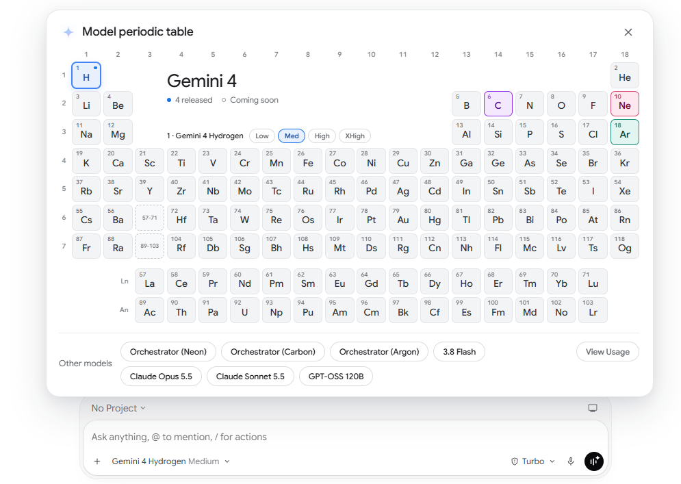

# Antigravity Periodic Model Picker

[](#)
[](#)
[](https://nodejs.org/)
[](#)

**English** | [简体中文](./README.zh-CN.md)

Replaces the expanded model dropdown in Google Antigravity Desktop with a periodic table selector.



## Features

- **Periodic table layout**: Maps element-named models (such as `Hydrogen`, `Carbon`, `Neon`, and `Argon`) onto the 118-element periodic grid, and groups other models (`Claude`, `GPT`, `Orchestrator`, `Flash`, etc.) in the bottom bar.
- **Thinking effort**: Switch model thinking effort (`Low`, `Med`, `High`, `XHigh`) directly from the panel.
- **Usage view**: Click `View Usage` to check 5-hour and weekly quota bars and reset times.
- **Theme sync**: Follows Antigravity's Light and Dark themes (`periodicTheme: "auto"`).
- **Shortcuts**: Toggle with `Alt+M`; hold `Alt` while clicking the model button to open the default menu.
- **Custom element mapping**: Bind any model name to a specific element tile via `customElementMappings` in `user/config.json`.

## Install

Requires **Node.js >= 22.0.0**.

Plugin directory:
- **macOS / Linux**: `~/.gemini/config/plugins/periodic-model-picker`
- **Windows**: `%USERPROFILE%\.gemini\config\plugins\periodic-model-picker`

### Agent Install
Send this repository URL (or local path) to the agent in Antigravity and ask it to clone or copy the project into the plugin directory above, read `SKILL.md`, and run installation and verification.

### Manual Install
Clone or extract this repository into the plugin directory above, open a terminal in that folder, and run:

```bash
node install.mjs doctor
node install.mjs install
node install.mjs verify
```

## Configuration

Edit `user/config.json` inside the plugin directory (`~/.gemini/config/plugins/periodic-model-picker/user/config.json` on macOS/Linux, `%USERPROFILE%\.gemini\config\plugins\periodic-model-picker\user\config.json` on Windows). Changes reload automatically on save and are kept across updates.

| Option | Default | Description |
| :--- | :--- | :--- |
| `periodicTheme` | `"auto"` | `"auto"`, `"dark"`, or `"light"` |
| `closeOnSelect` | `"effort"` | `"effort"` (click model to lock, then click effort to apply & close) or `"model"` (close immediately on model click) |
| `shortcut` | `"Alt+M"` | Keyboard shortcut to open or close the panel |
| `customElementMappings` | `{}` | Map model name substrings to an element (`79`, `"Au"`, or `"Gold"`) |
| `extraOtherModels` | `[]` | Extra model names to show in `Other models` |

## Rollback & Uninstall

```bash
node install.mjs verify --safe-mode
node install.mjs rollback
node install.mjs uninstall
```
