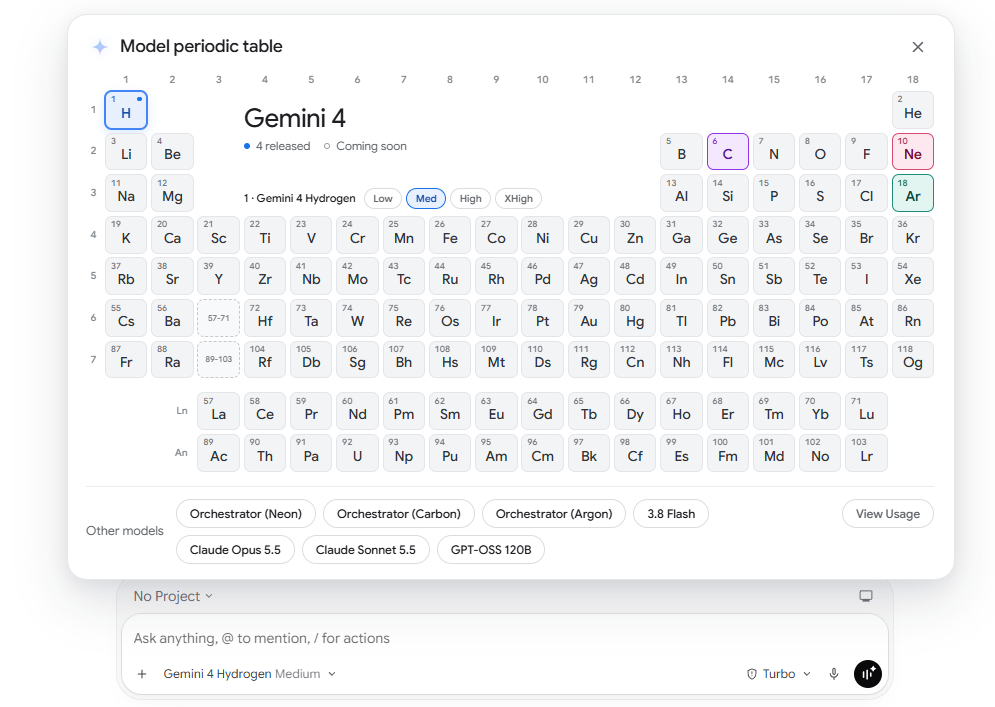

# Antigravity Periodic Model Picker

[](#)
[](#)
[](https://nodejs.org/)
[](#)

[English](./README.md) | **简体中文**

将 Google Antigravity 桌面版的模型选择展开菜单替换为元素周期表面板。



## 功能

- **元素周期表布局**：按化学元素命名的模型（如 `Hydrogen`、`Carbon`、`Neon`、`Argon`）显示在 118 元素周期表对应位置，其余模型（`Claude`、`GPT`、`Orchestrator`、`Flash` 等）归入底部 `Other models` 栏。
- **思考强度切换**：在面板内直接点击切换模型的思考档位（`Low`、`Med`、`High`、`XHigh`）。
- **用量查看**：点击右下角 `View Usage` 查看 5 小时与周度剩余配额及重置时间。
- **亮暗色同步**：跟随 Antigravity 主题切换亮色或暗色外观（`periodicTheme: "auto"`）。
- **快捷键**：`Alt+M` 打开或关闭面板；按住 `Alt` 点击模型按钮可打开默认菜单。
- **自定义元素映射**：可在 `user/config.json` 的 `customElementMappings` 中将任意模型绑定到指定元素格。

## 安装

需要 **Node.js >= 22.0.0**。

插件存放目录：
- **Windows**：`%USERPROFILE%\.gemini\config\plugins\periodic-model-picker`
- **macOS / Linux**：`~/.gemini/config/plugins/periodic-model-picker`

### 让 Agent 自动安装
在 Antigravity 对话中发送本仓库地址（或本地路径），让 Agent 将项目放入上述插件目录，并读取 `SKILL.md` 自动完成安装与校验。

### 手动安装
将本仓库克隆或解压到上述插件目录，在该目录打开终端执行：

```bash
node install.mjs doctor
node install.mjs install
node install.mjs verify
```

## 配置

编辑插件目录下的 `user/config.json`（Windows 为 `%USERPROFILE%\.gemini\config\plugins\periodic-model-picker\user\config.json`，macOS / Linux 为 `~/.gemini/config/plugins/periodic-model-picker/user/config.json`），保存后自动热生效，升级时保留原有配置。

| 配置项 | 默认值 | 说明 |
| :--- | :--- | :--- |
| `periodicTheme` | `"auto"` | `"auto"`、`"dark"` 或 `"light"` |
| `closeOnSelect` | `"effort"` | `"effort"`（点击模型先锁定，点击思考强度后再应用并收起）或 `"model"`（选择模型后立即收起） |
| `shortcut` | `"Alt+M"` | 打开或关闭面板的快捷键 |
| `customElementMappings` | `{}` | 模型名称关键字到元素的映射（如 `79`、`"Au"` 或 `"Gold"`） |
| `extraOtherModels` | `[]` | 额外显示在 `Other models` 栏的模型名称 |

## 回滚与卸载

```bash
node install.mjs verify --safe-mode
node install.mjs rollback
node install.mjs uninstall
```
